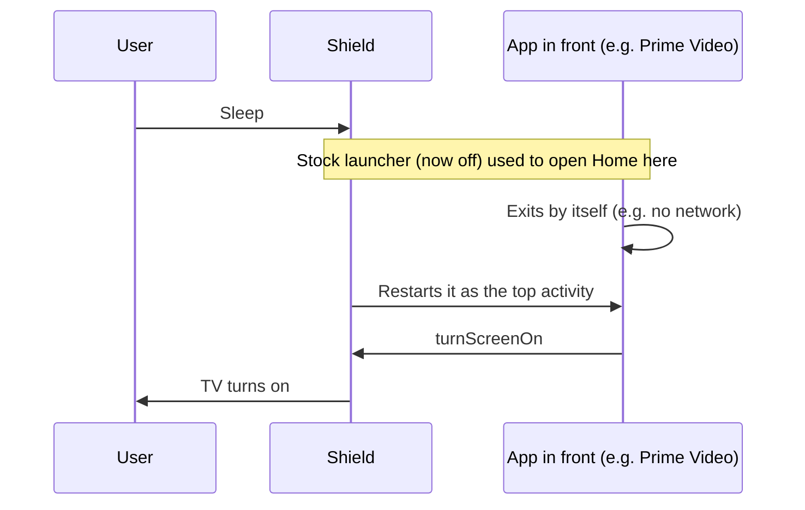

# NVIDIA Shield setup (done 2026-10-29)

Shield TV, Android 11, IP `192.168.110.211` (MAC `00:04:4b:74:5f:62`). It feeds the Pi over USB (see the project `CLAUDE.md`).

## Restore after a factory reset

1. On the Shield: Settings > Device Preferences > About > press Build 7 times. Then Developer options > Network debugging on.
2. Install Projectivy Launcher from the Play Store.
3. On the PC (Git Bash) or the Pi, run `bash shield/restore.sh`. Accept the ADB prompt on the TV ("Always allow").
4. In Projectivy, accept its accessibility prompt if it shows one.

The script does these steps:

| Step | Detail |
|---|---|
| Remove apps | Vudu, Play Music, Play Movies, Play Games, NVIDIA Games, `nvgamecast`, `nvidia.stats`, `nvidia.feedback`, `google.android.feedback` (`pm uninstall --user 0`) |
| Keep | Amazon Music, YouTube TV (`com.google.android.youtube.tvunplugged`) |
| Disable | `com.google.android.tvlauncher`, `com.google.android.tvrecommendations` (`pm disable-user --user 0`). The user does not want Google recommendations. |
| Install | `sleephome/sleephome.apk` (Sleep Home, below) |
| Accessibility | Turns on the Projectivy and Sleep Home services |

Undo one step:

| Undo | Command |
|---|---|
| Bring an app back | `adb shell cmd package install-existing <package>` |
| Stock launcher back | `adb shell pm enable com.google.android.tvlauncher` (and `tvrecommendations`) |

## Why Sleep Home exists

With the stock launcher off, an app left in front at sleep can wake the TV:

Sleep Home is an accessibility service (no screen, no permissions, reads no screen content). On each screen-off it opens Home, so no app stays in front. The screen-off signal comes 2-3 s after sleep. Log tag: `SleepHome`.

## Rebuild Sleep Home

Only needed after a code change. `sleephome/sleephome.apk` is a prebuilt copy.

1. Install JDK 17: `winget install Microsoft.OpenJDK.17`.
2. Install the Android command-line tools in `%LOCALAPPDATA%\Android\Sdk\cmdline-tools\latest`. Then run `sdkmanager "build-tools;34.0.0" "platforms;android-30"`.
3. Run `.venv\Scripts\python shield\sleephome\build.py`. The output is `shield/sleephome/build/sleephome.apk`.
4. Copy the output over `shield/sleephome/sleephome.apk`.

The build signs with `~/.android/debug.keystore`. With a new key, `adb install -r` fails: uninstall `com.joshi.sleephome` first.

## Debug a wake

- `adb logcat | grep -E "Waking up from|Going to sleep|SleepHome"`. The `START u0` line just before a wake names the app that woke it.
- The Shield keeps its log in RAM only. Unplugging it erases the log.
- The Pi logger `pi/bin/shield-wakelog` records each wake with the 60 log lines before it. It was used 2026-10-28/29 and is not running now.
  - Start it on the Pi: copy it to `~/bin/`, then run `nohup setsid ~/bin/shield-wakelog >/dev/null 2>&1 </dev/null &`.
  - Stop it: `kill -- -$(cat ~/shield-wakelog/pid)`.
  - It also calls `pi/bin/shield-sleephome`, the Pi-side Home step that came before the app. It is harmless next to the app.

## Other notes

- Self-wake 2026-10-28: tvrecommendations opened the launcher's boot-helper screen at each sleep, with turn-screen-on. Disabling it fixed that.
- Profiles: Netflix, Prime Video and HBO Max show no buttons to accessibility, and their screenshots are blocked. Auto-picking a profile is not possible without blind key presses. YouTube opens without a profile prompt.
- Storage: data moved off the flaky adopted USB drive on 2026-10-27; internal storage is primary. The user planned to eject and unplug the drive.
- CEC: `settings get global hdmi_control_auto_device_on_shield_enabled` read 0 on 2026-10-29.
